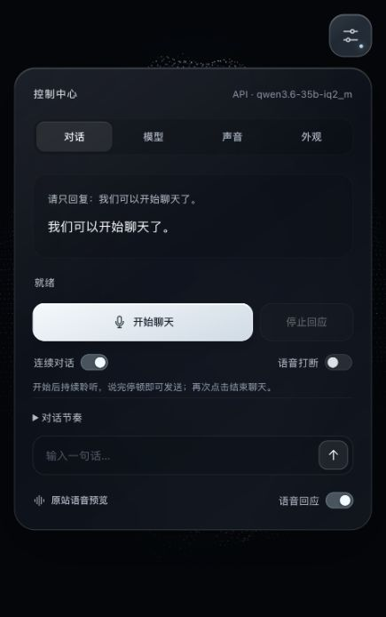

# Pioneer Face Voice

从 [Prepare to Pioneer](https://preparetopioneer.com/) 已发布前端中提取的粒子人脸，整理为可独立修改的项目，增加中文语音对话入口和可配置模型适配层。

**这不是原作者的完整开发仓库。** 已获得发布版人脸代码、Shader、贴图和依赖；没有获得原始 Vue/TypeScript 工程、后台源码或原站 AI 服务。详见 [来源说明](NOTICE.md) 和 `reference/`。


## 当前可以做什么

- 人脸默认占满整个视口，随窗口比例自动调整构图，保留完整脸部与原始比例。
- 只保留右上角一个控制按钮；对话、模型、声音与外观集中在 Apple 风格毛玻璃面板中。
- 独立运行原站粒子人脸：颜色/深度贴图、鼠标转动、冰白默认色与原站 6 种配色、说话时粒子波纹。
- 播放原站的短语音，直接检查声音与人脸动画联动。
- 配置 Ollama 原生接口，或 LM Studio 等兼容 Chat Completions 接口。
- 自带 Whisper Tiny / Base 两套多语种识别模型和运行资源，默认在本机离线识别录音，无需另开识别服务或提供识别 Key。
- 自动读取本机内存和处理器线程数，提供初选建议；识别模型、中文/英语/自动语言均可切换，选择在当前浏览器保留。
- 可选外部识别 API 或浏览器识别；对话模型保持独立的 API 配置。
- 默认连续聊天：一次开启麦克风，停顿后自动提交，回复结束后继续聆听；支持手动录音模式。
- 模型回复以流式文字显示，按句合成/播放，人脸随实际播放回应；可中止请求、播放和待播队列。
- “声音”页可选择实际可用的中文/其他语言音色并试听，调节语速和音高；选择自动保存，聊天回复使用所选声音。
- 可选择独立 TTS API，或启动项目提供的 Windows Qwen3-TTS 服务，用原站开场录音作为参考音色。

说话动画沿用原站的粒子变化，尚未实现逐音素口型。实时聊天采用“停顿识别 → 流式文本 → 逐句播报”，不是模型原生的双向音频流。实际等待时间取决于识别、对话服务与 TTS 的速度。



## 在 Mac 或 Windows 上启动

安装 Node.js 22 或更新版本以及 Git。运行项目本身不需要安装 npm 依赖。

```powershell
git clone https://github.com/Charlie500/pioneer-face-voice.git
cd pioneer-face-voice
node server.mjs
```

用 Chrome 或 Edge 打开 <http://127.0.0.1:4173/>。也可以双击 `scripts/start.cmd`。

在“对话”页点“开始聊天”，允许此 localhost 页面使用麦克风，环境声校准期间安静约 0.8 秒，出现“正在聆听”后说话。说完默认停顿 0.85 秒自动发送，每句最长 30 秒。勾选“语音回应”时按句播放回复并触发人脸回应；回复结束继续聆听。点“结束聊天”关闭麦克风；“停止回应”只停止当前回复，连续聊天继续。关闭“连续对话”可回到手动开始/结束录音。

“对话节奏”可调停顿时间和麦克风灵敏度。默认关闭“语音打断”，减少扬声器回声误触发；戴耳机时可开启，在回应中说话打断当前轮。文字发送也能打断旧回复。右上角按钮、面板外部或 Esc 可收起面板，收起时持续聊天不会停止。

仓库和完整 ZIP 均包含识别模型及 WASM 运行资源。使用内置识别与系统声音不需要 Python 或运行时下载模型。可选 Qwen3-TTS 单独需要 Python 3.12、运行依赖与 TTS 权重，首次启动下载。仍需配置可用的对话服务及其本地授权。Windows 操作见 [交接文档](WINDOWS_HANDOFF.md)。

## 内置语音识别

“模型 → 语音识别”默认选择“内置离线识别”。本机不足 8 GB 内存或不足 4 个处理器线程时初选 Tiny，其余初选 Base；这是资源建议，实际速度可用“用中文示例检查识别”检查。检查成功后，“用识别结果试聊”可验证识别文字到对话 API 的链路。

| 模型 | 随包资源 | 用途 |
| --- | --- | --- |
| Whisper Tiny · q8 | 约 43.1 MiB | 轻量选项 |
| Whisper Base · q8 | 约 77.5 MiB | 默认均衡选项 |

模型由 [Xenova/whisper-tiny](https://huggingface.co/Xenova/whisper-tiny)、[Xenova/whisper-base](https://huggingface.co/Xenova/whisper-base) 提供 ONNX 转换；固定版本和文件校验值见 `assets/speech/manifest.json`。模型在独立 Worker 中使用本机处理器运行，只把识别文字发送给对话 API。运行 `npm run verify:speech` 可检查打包完整性。

## 音色与试听

打开右上角控制中心 → “声音”，在“回应音色”中选择，再点“试听这个声音”。中文音色优先列出，其余按语言标签显示；“本机/在线”标记来自浏览器提供的音色信息。语速可在 0.70–1.30× 之间调整，音高可在 0.80–1.20 之间调整。修改即时保存在当前浏览器；聊天勾选“语音回应”时使用这些设置，试听可独立播放和停止。

自动声音优先选普通话。若某个已保存音色在新设备不可用，会提示并暂用自动声音；可重新选择。音色由操作系统/浏览器提供，Mac 和 Windows 的列表可能不同，不是项目内置的独立 TTS 模型。

“声音来源”还可切换为“本地 Qwen3-TTS · 参考音色”或“TTS API／其他本地服务”。填语音服务地址、模型、音色 ID 并保存；服务须接受 `POST /v1/audio/speech`（`model/input/voice/response_format=wav`）并返回可播放音频。“检查语音服务”读取模型列表，只有一个模型时会同步模型名；“试听”才验证实际合成。授权只填环境变量名称，密钥留在 Node 端。TTS 保持音色原始音高，语速仍可调。

原站预览是固定录音，无法直接替任意回复发声。项目提供的 Qwen3-TTS 桥接使用约 5 秒开场录音及对应文字作参考；声音相似度和跨语言表现需在 Windows 实听，不能保证复现原站声音。启动步骤见 [参考音色服务](WINDOWS_HANDOFF.md#可选原站参考音色或其他-tts-api)。

## 模型配置

点击右上角按钮，切换到“模型”。

| 服务 | 对话接口 | 服务地址示例 | 模型名 |
| --- | --- | --- | --- |
| Ollama | Ollama | `http://127.0.0.1:11434` | 从本机读取或填写实际安装名称 |
| LM Studio | 兼容 API | `http://127.0.0.1:1234/v1` | 本机服务返回的 identifier |
| 其他兼容服务 | 兼容 API | 服务提供的 HTTP/HTTPS 根地址或 `/v1` 地址 | 服务支持的名称 |

“读取已安装模型”会请求服务的模型列表，不下载模型。具体协议依据 [Ollama Chat](https://docs.ollama.com/api/chat)、[Ollama 模型列表](https://docs.ollama.com/api/tags)、[LM Studio Chat Completions](https://lmstudio.ai/docs/developer/openai-compat/chat-completions)。

如改用外部识别，先将“语音识别”切到“外部识别服务”，再在“授权与识别服务”中独立配置。服务须接受 `POST /v1/audio/transcriptions` 的 multipart 请求并返回 `{ "text": "识别结果" }`。本次 Qwen 对话服务实测 HTTP 501，明确不支持音频输入，不能兼作识别服务；默认内置模型解决这一缺项。

若服务需要授权，在界面填写**服务端环境变量的名称**，例如 `MODEL_API_KEY`。密钥值可以由启动 Node 的进程环境提供，也可以保存在项目根目录的本地 `.env` 中；服务器启动时自动读取该文件。不要把密钥值填写到页面、URL 或 `config/models*.json`。`.env` 被 Git 忽略，不包含在交接包中。本项目不创建凭据。

界面保存的配置位于 `config/models.local.json`，已被 Git 忽略，并优先于仓库默认配置 `config/models.json`。打开页面不会自动进行模型推理或开启麦克风。

本次默认配置已设为用户提供的局域网服务 `http://192.168.10.102:8080/v1`，模型为 `qwen3.6-35b-iq2_m`，接口类型为兼容 API，授权变量名为 `MODEL_API_KEY`。Mac 当前本地配置亦已同步，密钥仅保存在本机 `.env`。已通过项目代理收到真实回复“连接成功。”（约 1.7 秒），网页两轮对话也验证了上下文。Windows 新克隆或解压后仍需在该电脑配置自己的本地密钥，步骤见 [交接文档](WINDOWS_HANDOFF.md#本次已选的局域网模型)。

## 代码入口

| 文件 | 用途 |
| --- | --- |
| `src/ParticleFace.js` | 提取并格式化的人脸实现；粒子密度、大小、波纹、深度参数 |
| `src/shaders/face.vert.glsl`、`face.frag.glsl` | 原站人脸的顶点与片元 Shader |
| `src/FaceStage.js` | 独立渲染、相机、贴图、尺寸与交互宿主 |
| `src/VoiceController.js`、`src/voice-options.js` | 麦克风、识别、音色选择、播放、停止、说话状态 |
| `src/LocalSpeechRecognizer.js`、`src/speech-worker.js` | 内置模型加载、音频解码、WASM 识别与中止 |
| `src/LiveVoice.js`、`src/SpeechDetector.js`、`src/audio/vad-processor.js` | 连续录音、环境声校准、能量停顿检测与 WAV 提交 |
| `src/ReplyAudio.js`、`src/SentenceBuffer.js` | 逐句播报、最多两句预取、排序与中止 |
| `src/chat-client.js`、`src/event-stream.mjs` | 浏览器 SSE 流式回复、UTF-8 增量解码与完成检查 |
| `assets/speech/` | 随项目打包的识别模型、运行时、来源与 SHA-256 校验 |
| `index.html`、`style.css` | 单入口控制中心、毛玻璃样式与窄屏布局 |
| `src/main.js` | 面板开合、分栏切换、配色与对话流程；默认冰白由原站蓝宝石配色派生 |
| `src/model-adapter.mjs` | Ollama NDJSON / 兼容 SSE / 识别与 TTS 协议 |
| `tts/server.py`、`tts/setup.ps1`、`tts/start.ps1` | 可选 Windows 参考音色服务与安装/启动 |
| `server.mjs` | 本地页面服务器与模型代理 |
| `config/palettes.json` | 原站配色 |
| `reference/` | 发布版原始文件及提取依据 |

修改 GLSL 后运行 `npm run shaders` 并刷新页面。普通 JS/CSS 修改后直接刷新即可。

```powershell
npm test
```

测试只调用临时本地模拟服务，不调用真实模型、不使用真实密钥。原始提取的重现流程见 [提取说明](docs/EXTRACTION.md)。

## 交接状态

已在 Mac 验证真实 Qwen 流式回复、回复未完成时开始播放、连续麦克风环境校准/开启/结束，以及 TTS 未启动提示；Node 与 Python 模拟协议/中止测试均通过。此前两套内置模型的中文示例与两轮上下文也已验证。Windows 真人连续对话、回声抑制、参考音色合成/相似度、安装与 GPU 表现仍需验收，详见 [验证记录](docs/VERIFICATION.md)。

默认服务器只监听 `127.0.0.1`，用于个人本机开发。仓库保留第三方来源信息，未授予原站资源新的开源许可。
