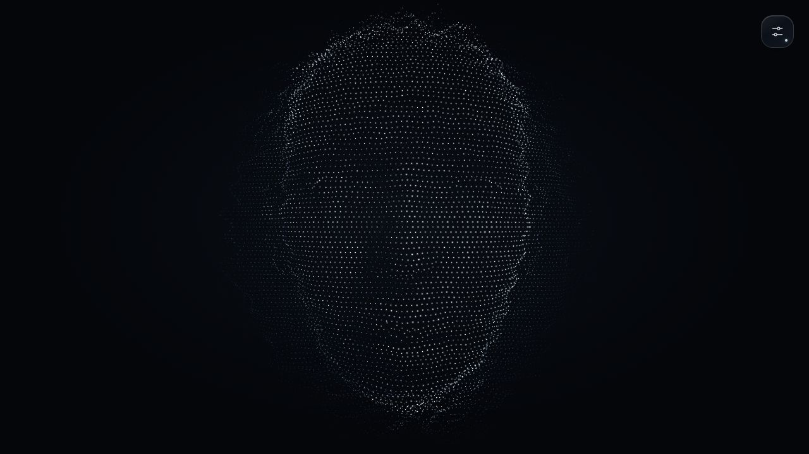
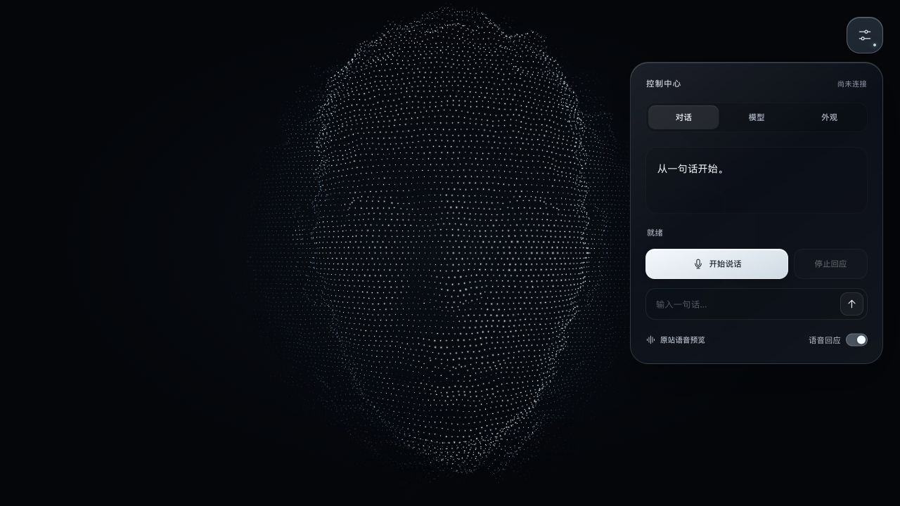

# Pioneer Face Voice

从 [Prepare to Pioneer](https://preparetopioneer.com/) 已发布前端中提取的粒子人脸，整理为可独立修改的项目，增加中文语音对话入口和可配置模型适配层。

**这不是原作者的完整开发仓库。** 已获得发布版人脸代码、Shader、贴图和依赖；没有获得原始 Vue/TypeScript 工程、后台源码或原站 AI 服务。详见 [来源说明](NOTICE.md) 和 `reference/`。



## 当前可以做什么

- 人脸默认占满整个视口，随窗口比例自动调整构图，保留完整脸部与原始比例。
- 只保留右上角一个控制按钮；对话、模型与外观集中在 Apple 风格毛玻璃面板中。
- 独立运行原站粒子人脸：颜色/深度贴图、鼠标转动、冰白默认色与原站 6 种配色、说话时粒子波纹。
- 播放原站的短语音，直接检查声音与人脸动画联动。
- 配置 Ollama 原生接口，或 LM Studio 等兼容 Chat Completions 接口。
- 按钮录音后发送至可配置的语音识别服务；也可选浏览器识别。
- 模型回复以文字显示，浏览器语音播放期间触发人脸回应；支持中止请求和播放。

说话动画沿用原站的粒子变化，尚未实现逐音素口型。当前是按轮次录音/识别/回复，尚未实现双向实时音频流。



## 在 Windows 上启动

安装 Node.js 22 或更新版本以及 Git。运行项目本身不需要安装 npm 依赖。

```powershell
git clone https://github.com/Charlie500/pioneer-face-voice.git
cd pioneer-face-voice
node server.mjs
```

用 Chrome 或 Edge 打开 <http://127.0.0.1:4173/>。也可以双击 `scripts/start.cmd`。

第一次点击右上角按钮，在“对话”页点击“原站语音预览”，再按 [Windows 交接文档](WINDOWS_HANDOFF.md) 连接本机模型和麦克风。再次点击右上角按钮、点面板外部或按 Esc 可收起面板，语音播放不会因此中断。

## 模型配置

点击右上角按钮，切换到“模型”。

| 服务 | 对话接口 | 服务地址示例 | 模型名 |
| --- | --- | --- | --- |
| Ollama | Ollama | `http://127.0.0.1:11434` | 从本机读取或填写实际安装名称 |
| LM Studio | 兼容 API | `http://127.0.0.1:1234/v1` | 本机服务返回的 identifier |
| 其他兼容服务 | 兼容 API | 服务提供的 HTTP/HTTPS 根地址或 `/v1` 地址 | 服务支持的名称 |

“读取已安装模型”会请求服务的模型列表，不下载模型。具体协议依据 [Ollama Chat](https://docs.ollama.com/api/chat)、[Ollama 模型列表](https://docs.ollama.com/api/tags)、[LM Studio Chat Completions](https://lmstudio.ai/docs/developer/openai-compat/chat-completions)。

语音识别服务在“模型 → 授权与识别服务”中独立配置，须接受 `POST /v1/audio/transcriptions` 的 multipart 请求并返回 `{ "text": "识别结果" }`。仅配置对话模型不会自动提供语音识别。

若服务需要授权，在界面填写**已有服务端环境变量的名称**，例如 `MODEL_API_KEY`；密钥值只由启动 Node 的进程环境提供，不填写到页面、URL 或配置文件中。本项目不创建凭据。

配置保存在 `config/models.local.json`，已被 Git 忽略。仓库默认模型名称为空，打开页面不会自动进行模型推理或开启麦克风。

## 代码入口

| 文件 | 用途 |
| --- | --- |
| `src/ParticleFace.js` | 提取并格式化的人脸实现；粒子密度、大小、波纹、深度参数 |
| `src/shaders/face.vert.glsl`、`face.frag.glsl` | 原站人脸的顶点与片元 Shader |
| `src/FaceStage.js` | 独立渲染、相机、贴图、尺寸与交互宿主 |
| `src/VoiceController.js` | 麦克风、识别、播放、停止、说话状态 |
| `index.html`、`style.css` | 单入口控制中心、毛玻璃样式与窄屏布局 |
| `src/main.js` | 面板开合、分栏切换、配色与对话流程；默认冰白由原站蓝宝石配色派生 |
| `src/model-adapter.mjs` | Ollama / 兼容 API / 语音识别协议 |
| `server.mjs` | 本地页面服务器与模型代理 |
| `config/palettes.json` | 原站配色 |
| `reference/` | 发布版原始文件及提取依据 |

修改 GLSL 后运行 `npm run shaders` 并刷新页面。普通 JS/CSS 修改后直接刷新即可。

```powershell
npm test
```

测试只调用临时本地模拟服务，不调用真实模型、不使用真实密钥。原始提取的重现流程见 [提取说明](docs/EXTRACTION.md)。

## 交接状态

已在 Mac 验证全屏人脸、桌面/窄屏毛玻璃控制中心、原站音频的说话状态、配置界面和接口模拟测试。Windows 的真实模型、语音识别、中文发声和 GPU 表现仍需验收，详见 [验证记录](docs/VERIFICATION.md)。

默认服务器只监听 `127.0.0.1`，用于个人本机开发。仓库保留第三方来源信息，未授予原站资源新的开源许可。
