# 本次交接验证

日期：2026-10-09。客户端：Apple Silicon Mac。Node.js：22.22.2。已从 Mac 调用用户提供的局域网模型服务；Windows 浏览器、麦克风与声音的实机验收仍待接手。

## 最新：连续聊天、流式回复与 TTS 接入

本轮在 Mac 内嵌浏览器执行真实页面操作，并调用已经授权的 LAN Qwen。TTS 真模型按用户要求留到 Windows，不在 Mac 下载或运行其权重。

| 检查 | 实际结果 |
| --- | --- |
| LAN Qwen 流式协议 | 项目 `/api/chat/stream` 收到 34 个文字 delta；单次请求首段约 8,580 ms，文本结束约 8,813 ms。只代表一次文本请求，不是语音全链路延迟 |
| 网页边生成边播报 | 回复仍停留在第三句开头时，页面已显示“正在回应”，人脸进入播放状态，截图见下。播放使用当前系统 voice，不是参考音色合成 |
| 中止 | 在模型等待期间点击“停止回应”显示“已停止”、禁用停止按钮；队列单元测试确认当前音频、预取与迟到回调全部失效 |
| 连续麦克风 | 新 AudioWorklet 路径成功进入“正在聆听，说完停顿即可发送。”，点击“结束聊天”显示麦克风已关闭；没有把此启动检查当作真人两轮验收 |
| 环境声处理 | 初次持续开启时环境声触发了无效识别。本轮增加 0.8 秒噪声校准、相对能量门槛、短噪声过滤，并默认关闭语音打断。修改后重新启动/校准/结束检查通过，复杂环境与扬声器回声仍待 Windows 实测 |
| TTS 配置 | 系统声音、Qwen 参考音色、通用 TTS API 均可切换；模型/音色/地址/语言/服务端授权名称字段可保存。未启动的 Qwen 服务显示清楚的连接失败提示 |
| TTS WAV 浏览器播放链路 | 临时 localhost 测试服务标记为 `fixture-tts-playback`，返回项目已有的中文测试 WAV。读取唯一模型同步成功，Node 代理 → Blob Audio 实际进入“正在回应”，停止试听成功；这是预录音协议检查，不是真 TTS 合成/音色验证。测试服务已停止，配置恢复系统声音及 Qwen 默认字段 |
| 参考音频 | 原站公开 `c_journey.mp3` 约 5 秒，生成单声道 24 kHz PCM WAV；文件来源及 SHA-256 已加入清单。“听原站参考音频”播放入口与停止检查通过 |
| 窄屏 | 请求 390×844 预览；内嵌浏览器报告页面 CSS 宽度 354，scrollWidth 亦为 354，无横向溢出。TTS 面板可内部滚动（673 高 / 1122 内容高）；临时尺寸已恢复 |
| Node 自动化 | `npm test`：33 项通过，0 失败。覆盖 SSE/NDJSON、UTF-8 分片、首段早到、提前断流、JSON 降级、服务端授权、代理中止、VAD/校准、连续状态与音频队列竞争 |
| Python 桥接协议 | `tts/test_server.py`：2 项通过，使用 FastAPI 0.142.4 / HTTPX 0.28.1 / Python 3.14 的独立测试环境和假引擎；验证授权、模型/音色/格式校验、二进制音频、排队取消、活动推理锁。没有执行 Torch / Qwen 模型 |
| 识别资源 | 本轮重新执行 `npm run verify:speech`：32 文件 / 142.1 MiB，大小和 SHA-256 全部通过 |
| 控制台 | 连续录音及真实 Qwen 页面检查没有 JS 警告/异常；探测未启动 TTS 时预期 HTTP 错误与界面提示相符。最终重新加载系统模式检查无异常 |

实现使用能量停顿检测和完整语句识别，再流式生成文本、逐句合成与播报；不是原生音频 token 流。原站粒子波纹与实际播放生命周期联动，尚无逐音素口型。Windows 仍须测真人识别准确率、回声、打断、首段/总等待时间、TTS 安装/GPU/自然度与相似度。

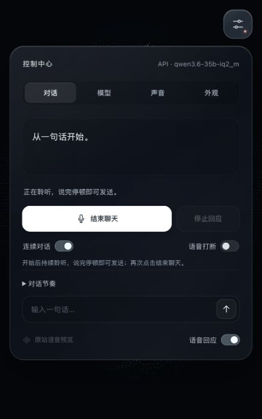

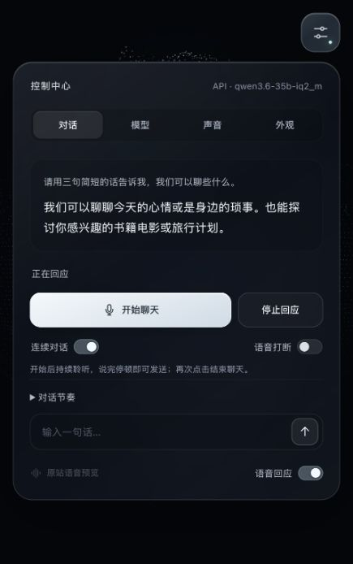

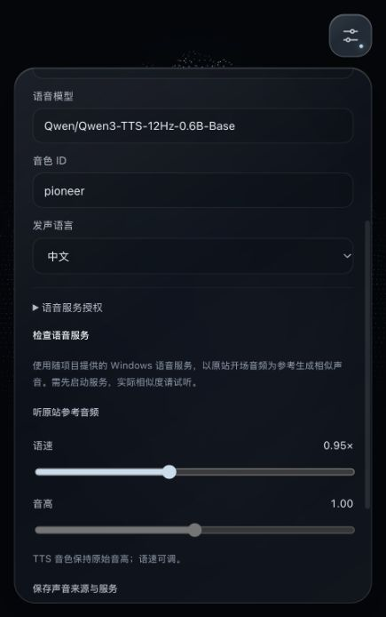

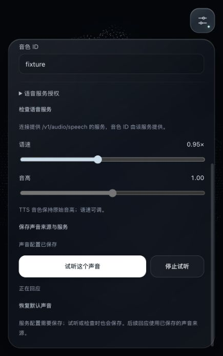

## 此前界面与回归验证

| 检查 | 证据与结论 |
| --- | --- |
| 独立项目启动 | `node server.mjs --port 4173`，本地页面与资源正常返回 |
| 实际 WebGL 画面 | Chrome 在 1280×720 和 390×844 视口显示完整粒子头部；画布尺寸覆盖视口，无横向溢出 |
| 默认界面 | 冰白配色，只有右上角一个可见按钮；人脸按高度或宽度自动贴合，保留脸部比例 |
| 毛玻璃控制中心 | 桌面与窄屏截图可见半透明背景、模糊效果、细边框；对话/模型/声音/外观四个分栏可操作 |
| 面板交互 | 右上角按钮、面板外部点击和 Esc 收起；方向键切换分栏；展开高级字段后可滚动到保存按钮 |
| 配色 | 冰白与原站紫晶切换后画面和选择状态同步更新 |
| 原站音频联动 | 播放时人脸回应；收起面板继续播放；立即中止显示“已停止”，恢复待机 |
| 缺少模型配置 | 文字发送显示需要填写模型服务/名称，不产生虚构回复 |
| 外部识别未配置（此前） | 旧默认模式被配置检查拦住；本轮已改为自带离线识别，外部服务改成可选 |
| 配置保存 | 桌面和窄屏均可保存表单并返回对话；本地配置被 Git 忽略，保存本身不触发模型推理 |
| 模拟协议/状态测试 | `npm test`：14 项通过，0 失败；增加离线识别中止、重新开始、录音释放与浏览器引擎启动状态；不调用真实模型或凭据 |
| 控制台 | Chrome 最终检查没有运行警告或错误；内嵌浏览器交互检查亦通过 |

此前交接已验证发布版 `Tz`、`FE` 及 548 个运行依赖声明/语句的重现提取、原始资源校验、URL 查询参数拒绝与私有文件保护。人脸代码与贴图沿用此前结果；本轮额外取得开场音频，来源已记录。

独立宿主修复了首帧 RAF 时间戳早于初始化 `performance.now()` 时产生负时间的问题；时间步长保持非负，避免原站噪声计算出现 NaN 后造成持续空白。

测试涵盖 Ollama 原生协议、兼容 API 授权及根路径、STT multipart 格式、错误信息、中止上游请求、私有文件不被静态服务暴露、配置存储、浏览器识别结束和播放回调的状态竞争。

## 截图

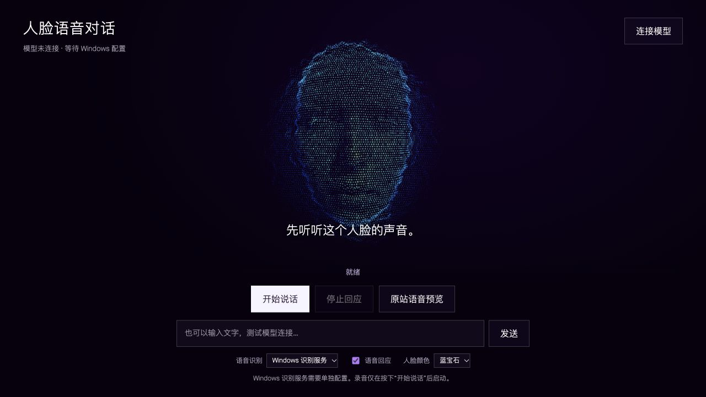

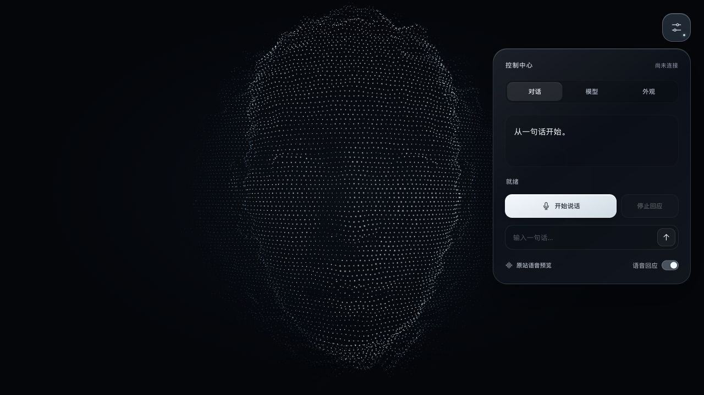

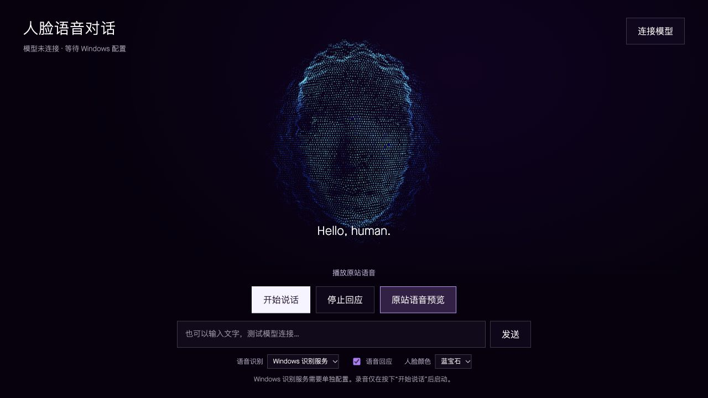

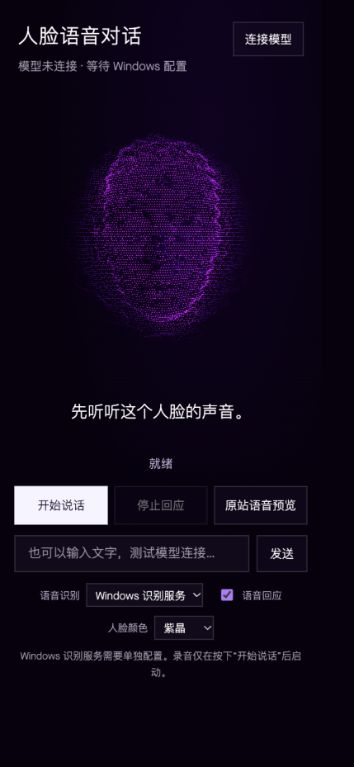

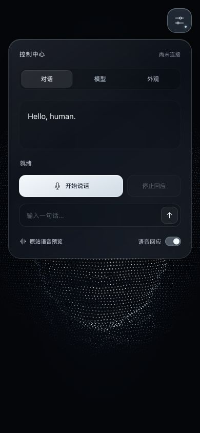

## 局域网模型的真实授权与对话

用户提供的地址 `http://192.168.10.102:8080/v1` 已配置为兼容 API，模型为 `qwen3.6-35b-iq2_m`，授权变量名为 `MODEL_API_KEY`。密钥仅存于本机被忽略的 `.env`；服务器启动时读取，不发送给网页。无授权请求此前返回 HTTP 401。

| 检查 | 实际结果 |
| --- | --- |
| 项目 `/api/models` | HTTP 200，返回上述模型名 |
| 项目 `/api/chat` | HTTP 200，收到“连接成功。”，本次请求约 1.7 秒；此时间仅代表一次短请求 |
| 网页第一轮 | 输入“记住我的称呼是小林。请只回复：你好，小林。”，显示“你好，小林。” |
| 网页第二轮 | 询问之前的称呼，显示“小林”，随后回到“就绪” |
| 网页状态 | 勾选语音回应时观察到“正在回应”，随后恢复就绪；本次未实听验收中文音频 |
| 网页控制台 | 内嵌浏览器本次检查没有警告或错误 |

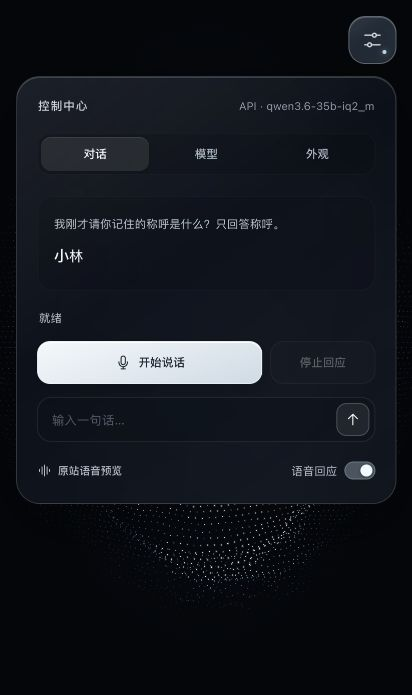

新克隆使用仓库默认配置；已有本地配置优先。服务端自动化测试使用临时模拟服务与模拟密钥，不访问用户的局域网服务。

## 此前内置离线识别验收

故障原因已实测：旧页面默认“本地识别服务”，但该服务为空；切换浏览器识别后返回 `network`。用户的 Qwen 对话服务接受真实音频识别请求后返回 HTTP 501，明确说明当前模型不支持音频输入。本轮将识别能力作为独立的随包模型提供，不再依赖这两条失败路径。

| 检查 | 实际结果 |
| --- | --- |
| 本机硬件 | `/api/hardware`：macOS、ARM64、16 GB 内存、8 个处理器线程；资源规则初选 Base，并允许手动选择 |
| Whisper Base q8 | 网页真实识别本次合成的中文示例，输出“你好,我想和你聊天,請用中文介紹自己。”，含模型准备约 5.3 秒 |
| Whisper Tiny q8 | 同一中文示例输出“你好,我想和你聊天,请用中文介绍自己”，含模型切换约 2.2 秒；时间仅代表这次短音频 |
| 识别到对话 | 点击“用识别结果试聊”，Qwen 回复“你好！我是你的语音助手，温和又直接，随时准备陪你聊天。今天想聊些什么呢？” |
| 实际麦克风入口 | 允许访问后的 MediaRecorder 成功进入“正在录音”；按“停止回应”回到“已停止”。此检查主动取消录音，没有把环境声音作为对话输入 |
| 配置保留 | 当前内嵌浏览器刷新后仍保留内置识别、所选 Tiny 和中文；随后重新选择推荐 Base |
| 资源完整性 | `npm run verify:speech`：32 个文件，142.1 MiB，大小及 SHA-256 均通过；每个模型固定发布方 revision |
| 离线加载方式 | Worker 设置禁止远程模型，仅使用本机打包模型与 WASM；运行时无需访问模型库或 CDN。没有关闭主机网络的实测 |
| 控制台 | 最终网页检查无警告或错误 |

识别在独立 Worker 中运行，停止时终止仍在计算的 Worker，正常切换模型时释放旧 pipeline，页面离开时清理。录音最长 30 秒，提供中文/英语/自动语言选项。默认单入口、全屏人脸与毛玻璃界面保持原样。

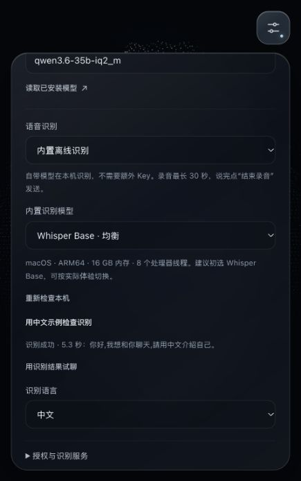

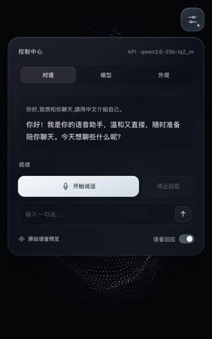

## 音色选择验收

- 当前 Mac 内嵌浏览器实际读取到 19 个中文音色，包括婷婷、美嘉及 Eddy、Flo 等；中文和其他语言分组，显示本机/在线标记。Windows 音色列表尚未实测。
- 选择“美嘉”，语速与音高均调至 0.95，点击试听后观察到“正在回应”、可停止状态与人脸回应；自然结束显示“试听结束”。再次播放后立即停止，回到待机。
- 刷新后仍选中美嘉、0.95 语速与 0.95 音高。此检查验证真实播放生命周期和设置保留，音质偏好仍由用户试听决定。
- 新增自动化检查确认播放使用所选 voiceURI、对应语言、语速与音高；旧设备的音色不可用时优先回退到普通话，异常调节值规范化。

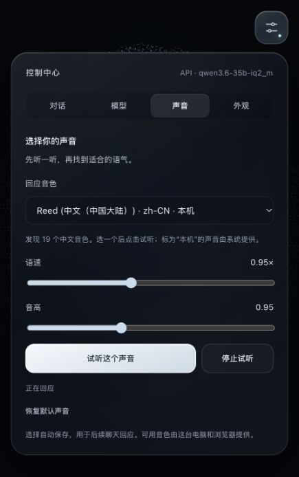

## 仍需 Windows 实测

文字推理、两轮上下文、真实文字流、逐句播放生命周期、Mac 内置中文示例识别与连续麦克风启动已通过上述检查。真人连续中文对话、回声/语音打断、中文声音实听、Windows 复测、Qwen3-TTS 安装与真实音色/速度、GPU 与全链路离线能力仍需验证。当前对话使用局域网 API，不能记为全链路离线。Windows 脚本已经提供，真实结果请填写 `WINDOWS_TEST_RECORD.md`。

Windows GitHub Actions 配置保留在 `docs/windows-ci.example.yml`，当前未启用、未运行。当前 GitHub CLI 凭据不包含 `workflow` 写入权限，故没有把模板放入 `.github/workflows/`。Windows 接手后若启用它，仅运行上述模拟测试，不下载或启动大模型；不能把本地测试结果视为 CI 结果。
